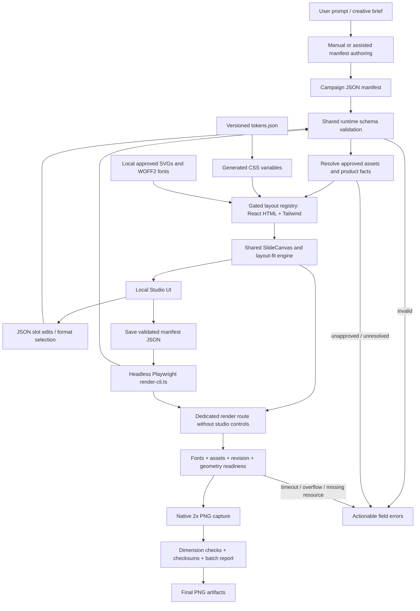

# TokenGateway Creative Studio — Master Execution Blueprint

**Role:** Principal Software Architect & Lead Project Orchestrator (Mandor Proyek)  
**Date:** 12 October 2026  
**Status:** Planning and product/design brief deliverables complete; implementation has not started.  
**Execution authority:** This document defines the build sequence and release gates. Completing this planning task does not initiate scaffolding, dependency installation, asset generation, or deployment.

## Project mandate and evidence baseline

Build a local creative studio that turns structured campaign content into deterministic, brand-correct social graphics. TokenGateway serves Indonesian developers using Cursor, Cline, and VS Code through an AI API proxy with domestic QRIS payments and no credit card requirement in the owner's brief. Later public-catalog research clarifies that the current Rp10.000 entry offer is a token-quota pass: GLM 5.3 Flash, 50,000,000 tokens, valid for 7 days. Do not describe that offer as unrestricted wallet credit. Publishable facts must be recorded in the runtime product facts registry before campaign export. [Current package source](https://tokengateway.ai.id/api/v1/catalog/packages).

### Product and design brief update — 12 October 2026

Read [briefs/README.md](briefs/README.md) before implementation. It indexes the product, catalog facts, owner-supplied logo, brand guidelines, design-system specification, content strategy, campaign copy, and next-session build prompt.

**Latest owner-directed build order:** first build the local Creative Studio dashboard MVP: campaign CRUD, editor, persistence, JSON IO, and a clearly labelled draft renderer adapter. Then build the content design system and real blueprint renderers in a separate session and integrate them through the same adapter. Use [dashboard prompt](briefs/08_DASHBOARD_BUILD_PROMPT.md) and [content design-system prompt](briefs/09_CONTENT_DESIGN_SYSTEM_PROMPT.md). Customer account/balance/payment dashboard functionality remains part of the existing TokenGateway website and is outside this studio build.

This updates the initial implementation order without weakening final-render dependencies. The dashboard MVP can run before production fonts/assets/blueprints exist, using validated data contracts and draft geometry. Native final PNG capture still requires the completed content design system, resolved required facts/assets, fitting and readiness gates. Original phase milestones below describe final subsystem readiness; early dashboard MVP does not mark M2/M3/M4 production gates complete.

The owner supplied a [logo JPEG](briefs/assets/tokengateway-logo-reference.jpeg), now the identity reference. Its vector master still needs preparation. The public catalog now supplies 21 packages and 18 model labels; docs establish the base URL `https://tokengateway.ai.id/v1`. Pricing source computes a 0.8% service fee; distinguish package price from checkout total. No login, checkout, inference request, or exact tool-configuration walkthrough was performed. Evidence, source conflicts and snapshots are recorded in [website research](briefs/sources/WEBSITE_RESEARCH.md) and [package facts](briefs/02_PACKAGES_AND_FACTS.md).

The palette later in this document is aligned to the owner-logo proposal in [brand guidelines](briefs/03_BRAND_GUIDELINES.md). The proposed primitive colors are not a pre-existing canonical brand master. Previously unknown prices/endpoint are now public-source facts; operational verification and runtime fact-registry implementation remain tasks.

The intended visual language is minimalist Swiss-tech: deliberate typography, aligned grids, restrained cyan accents, authentic provider marks, and generous negative space. No decorative cables, floating object clutter, generated brand approximations, fake QR matrices, blurred glass, or text rendered into low-resolution images.

| Requirement | Binding decision |
|---|---|
| Instagram carousel | Fixed 1080 × 1350 CSS-pixel canvas; 80px safe inset on all sides |
| TikTok / Instagram Story | Fixed 1080 × 1920 CSS-pixel canvas; minimum 140px top and 160px bottom inset; explicit platform overlay profiles |
| Export | Native PNG capture at `deviceScaleFactor: 2` and screenshot `scale: "device"` |
| Expected output sizes | 2160 × 2700 and 2160 × 3840 physical pixels |
| Studio | Local live preview, JSON slot editing, format toggle, zoom, slide navigation |
| Layouts | Exactly five initial registry keys: `HERO_HOOK`, `PROBLEM_COMPARISON`, `MODEL_CATALOG`, `CODE_MOCKUP`, `PRICING_OFFER` |
| Typography | Self-hosted Plus Jakarta Sans and JetBrains Mono; no remote font dependency during capture |
| Assets | Approved TokenGateway hexagonal circuit node, GLM angular Z, DeepSeek blue whale, Gemini four-point sparkle, and official QRIS text badge |
| Export policy | Invalid data, unverified required claims, missing approved assets, failed fonts, or unsafe geometry block final export |

### Workspace and external evidence inspected

- The workspace was empty at inspection: no application, package manifest, assets, tests, or existing execution plan. No applicable ancestor `AGENTS.md` was found in the checked workspace path.
- The [TokenGateway site](https://tokengateway.ai.id/) returned HTTP 200 through a read-only fetch. Initial home HTML exposed navigation and a brand asset. Subsequent public docs/catalog research established published package values and endpoint details; runtime tool compatibility and payment behavior remain untested.
- The site's [existing mark](https://tokengateway.ai.id/brand/tokengateway-mark.svg) is an SVG wrapper containing a 512 × 512 embedded PNG. It is a reference candidate, not a verified path-based master for this pipeline. Phase 0 must resolve this before brand-correct export.
- Official provider and payment sites are source candidates, not proof that a particular downloaded logo variant is approved. Asset acquisition, visual comparison, and provenance remain Phase 0 work.
- Playwright capture, font readiness, and visual comparison behavior were checked against primary documentation. Technical references appear beside the relevant decisions below.

**Open inputs that block only dependent production work:** a TokenGateway vector master faithful to the supplied logo; verified GLM Z variant; exact Gemini sparkle variant; authentic DeepSeek and QRIS vectors; verified Cursor configuration in the target version; token-accounting/pooling/expiry behavior beyond published package fields; evidence for any named `$20/month + credit card` comparator. The base URL and package model IDs are now known from public sources. Foundations and draft previews may proceed while remaining inputs are resolved. Production exports using unresolved required inputs may not.

---

## Chapter 1 — System Architecture & Data Flow

### 1.1 Architecture and trust boundaries



The authoring stage may be manual or assisted. An integrated AI prompt service is outside the initial build: no API keys or nondeterministic model calls are needed to preview or render. A future assistant may propose JSON; it must pass the same contract as imported files.

The studio and renderer consume the same normalized manifest, registry, fonts, assets, design tokens, and fit engine. The studio is not a separate rendering implementation. It adds editing controls around `SlideCanvas`; the capture route renders only that canvas at native dimensions.

### 1.2 Separation of concerns

| Layer | Owns | Must not own |
|---|---|---|
| Design tokens | Semantic colors, typography, spacing, borders, format dimensions, safe profiles, text-size limits | Campaign copy, prices, URLs, provider-specific path geometry |
| Component atoms | Text slots, verified brand marks, category tags, money and quota displays, rules, code lines | File IO, campaign persistence, arbitrary HTML rendering |
| Component molecules | Comparison panels, model cards, IDE window, offer panel, footer | Registry selection, network capture, user-controlled CSS |
| Layout blueprints | Slot arrangement, format-specific composition, fit budgets | Editing state, browser launching, claim approval |
| Campaign payloads | Copy, slide order, allowed layout selection, references to product facts | SVG markup, arbitrary image paths, styles, scripts, free-form HTML |
| Shared contracts | Validation, normalization, discriminated slide schemas, error codes | Rendering side effects, local storage |
| Studio | Draft state, validation UX, undo/redo, persistence, preview zoom | Screenshot geometry or export-only content forks |
| Render pipeline | Local server lifecycle, native capture, report, artifacts | Invented copy, silent data repair, publishing to social platforms |

### 1.3 Proposed repository boundaries

```text
EXECUTION_PLAN.md
package.json / package-lock.json
index.html / vite.config.ts / tsconfig*.json
src/
  contracts/       campaign.schema.ts, formats.ts, errors.ts
  design/          tokens.json, tokens.generated.css, fonts.css
  assets/          registry.ts, provenance.json
  facts/           product-facts.json, facts.schema.ts
  components/
    atoms/         typography, brand mark, tag, money, quota
    molecules/     model card, comparison panel, IDE card, footer
  blueprints/      five layout modules, registry.ts
  canvas/          SlideCanvas.tsx, fit.ts, geometry.ts, readiness.ts
  studio/          stage, navigator, editor, state, persistence
  render/          RenderPage.tsx, render protocol
  styles/          base.css, studio.css, capture.css
public/
  brand/           approved local SVG assets
  fonts/           approved WOFF2 files and licenses
campaigns/         versioned example manifests
scripts/           build-tokens.ts, render-cli.ts
tests/
  contracts/       invalid data and fact-reference fixtures
  rendering/       readiness, geometry, capture and batch cases
  visual/          approved baselines and challenging fixtures
artifacts/         generated outputs, ignored by source control
```

Names above are proposed implementation destinations, not existing files. Keep this a single application with a Node CLI, not a microservice system. Use Vite, React, TypeScript strict mode, Tailwind with statically declared classes, a shared runtime schema library such as Zod, and Playwright Chromium. Use npm plus one committed lockfile. Phase 0 selects compatible stable versions, records their Node engine requirements, and pins the toolchain; do not assume a version from this plan is installed.

Tokens are compiled into CSS custom properties by a small build tool. Commit the source of truth; regenerate during build and check for drift. Tailwind utilities reference semantic tokens. Campaign JSON cannot construct class names, which avoids missing production CSS and uncontrolled design variants.

### 1.4 Render and persistence boundaries

- Studio route `/`: interactive preview, safe-area guides, editor, validation panel, and local draft recovery.
- Capture route `/render`: accepts a validated serializable render request through a narrowly scoped browser function installed by the page. CLI waits for that function before injecting the request with `page.evaluate`; do not embed raw JSON in HTML or put campaign content in query strings.
- Render request identifies campaign revision, slide ID, format, safe profile, and expected content hash. Readiness reports the same values, eliminating stale-slide capture.
- Persistence uses versioned local drafts and explicit JSON import/download. Imported data is size-limited, parsed, validated, then committed atomically. Draft recovery does not imply export validity.
- CLI reads files from disk, starts or connects to a verified loopback server, captures the production build, and writes PNGs plus a machine-readable report. The browser UI does not execute shell commands. A future one-click batch-export bridge is a separate feature, not a hidden localhost command endpoint.
- Capture uses local assets only. Block unexpected external requests; bind the server to `127.0.0.1`; keep credentials out of manifests. No backend, authentication, payment processing, or social publishing is part of this studio.

### 1.5 Dependency order and bottlenecks

```text
P0 toolchain + schema agreement + asset/fact audit
  ├─ First: dashboard MVP, editor/persistence + draft renderer adapter
  └─ Next: P1 content tokens/fonts/geometry
            └─ P2 HERO + remaining blueprints + fit/readiness
                 └─ P3 integrate real renderers into existing dashboard
                      └─ P4 production batch capture
                           └─ P5 hardened release fixtures
```

The final-capture critical path is verified assets → reliable fonts → shared native canvas → bounded text fitting → capture readiness. Early dashboard CRUD/editor/persistence can proceed with a draft renderer after schema agreement. Test a thin `HERO_HOOK` capture when building the content system in Phase 2; Phase 4 remains responsible for the complete CLI and batch lifecycle. Schema and geometry tests begin with their owning subsystems, rather than waiting until Phase 5.

Authentic asset sourcing and unambiguous commercial facts are external-input bottlenecks. Deterministic typography, long URL fitting, stale async revisions, platform overlay exclusions, and production CSS parity are engineering bottlenecks. Each has a specific gate in Chapter 4.

---

## Chapter 2 — Component Registry & Contract Specification

### 2.1 Manifest envelope

The implementation will use one discriminated runtime schema and derive TypeScript types from it. The specification below describes that contract; it is not application scaffolding.

| Field | Type / rule |
|---|---|
| `schemaVersion` | Exact supported version, initially `"1.0.0"`; unsupported versions fail with a migration message |
| `campaignId` | Stable lowercase slug, 1–64 ASCII characters; letters, digits, hyphens only |
| `name` | Nonempty plain text, up to 100 Unicode code points |
| `locale` | `"id-ID"` initially |
| `designRevision` | Exact supported token/blueprint revision |
| `factsRevision` | Exact revision of the bundled product facts snapshot |
| `formats` | Unique nonempty subset of `"IG_CAROUSEL"`, `"VERTICAL"` |
| `verticalProfiles` | If vertical selected: unique nonempty subset of `"IG_STORY"`, `"TIKTOK"` |
| `slides` | Ordered array, 1–30 slides; unique stable slide IDs |
| slide `id` | Slug, 1–64 characters; never inferred from title text |
| slide `layout` | One of the five exact registry keys |
| slide `props` | Strict object matching the selected layout; unknown keys rejected |
| slide `formatOverrides` | Optional format-keyed patches for explicitly allowed text slots only; merged result fully revalidated |

Limit a manifest file to 1 MiB. Reject nonfinite numbers, unsupported enums, unknown properties, control characters inappropriate for display, and missing required values. Normalize line endings and Unicode consistently; preserve intended punctuation and meaningful newlines. Resolve links and numbers through typed fields, never through a string-to-HTML conversion.

`formatOverrides` cannot change assets, prices, quota, claims, endpoints, layout identity, or safety settings. It may replace title/subline copy within the same field limits. Profile selection is independent of format: Story and TikTok share the 9:16 dimensions but can need different exclusions. A mixed-platform campaign produces separate vertical artifacts when both profiles are requested.

Minimal draft manifest example:

```json
{
  "schemaVersion": "1.0.0",
  "campaignId": "coding-pakai-qris",
  "name": "Coding Pakai QRIS",
  "locale": "id-ID",
  "designRevision": "swiss-tech-v1",
  "factsRevision": "product-facts-v1",
  "formats": ["IG_CAROUSEL", "VERTICAL"],
  "verticalProfiles": ["IG_STORY", "TIKTOK"],
  "slides": [
    {
      "id": "hook",
      "layout": "HERO_HOOK",
      "props": {
        "title": "Coding AI, bayar pakai QRIS.",
        "highlight": "QRIS",
        "categoryTag": "UNTUK DEVELOPER INDONESIA",
        "subline": "Satu gateway untuk workflow coding kamu."
      }
    }
  ]
}
```

The example is an authoring fixture. Its revision references must actually exist and pass gates before export.

### 2.2 Registry entry contract

Each registry entry provides:

- `key`, immutable blueprint `version`, and `supportedFormats` containing both initial dimensions.
- Runtime props schema; editor slot descriptors; deterministic sample fixture.
- `requiredAssetIds(props)` and `requiredFactIds(props)` resolvers.
- Format/profile-specific composition metrics and text fit policies.
- React component receiving only normalized props and a `RenderContext`.

`RenderContext` contains dimensions, safe rectangle, profile ID, token revision, resolved approved assets/facts, manifest revision, and render mode. Theme, font choice, and arbitrary per-slide padding are not payload options.

The registry is a static allowlist, not a dynamic import path taken from JSON. A new blueprint requires its schema, both format arrangements, editor descriptors, fixtures, geometry checks, and approved visual baselines before registration.

### 2.3 Asset and commercial-fact contracts

**Asset IDs:** `tokengateway.mark`, `glm.z`, `deepseek.whale`, `gemini.sparkle`, `qris.badge`. Payloads select providers by enum; the registry selects assets. Users cannot supply logo paths or markup.

Each asset provenance record includes source URL or supplied master reference, retrieval date, SHA-256, intrinsic `viewBox`, canonical colors, permitted variants, visual-review status, and reference to applicable usage instructions. Approved files are local and immutable by hash. SVG inspection rejects scripts, `foreignObject`, remote references, embedded raster images, and unexpected filters. Sanitization must preserve approved paths and gradients, followed by visual comparison.

The facts registry records stable fact IDs, structured values, evidence references, verification date, expiry where appropriate, and verification status. Manifests reference facts; they cannot approve them. An offer fact identifies whether Rp10.000 purchases wallet credit or a documented token bundle, which model/rate conditions apply, and any expiry. Comparator facts identify the actual product/plan, currency, billing interval, card requirement, and date. Integration facts identify exact endpoint, model ID, Cursor version and tested setup steps.

Validate structured amounts, units, endpoints, model IDs, and reference existence automatically. Arbitrary natural-language descriptions also require campaign copy review against those facts; a schema cannot prove the meaning of unrestricted prose. Record the reviewed normalized copy hash alongside campaign release evidence, and invalidate that review when claim-bearing text changes. Price/availability facts have an explicit `validUntil`; integration facts must be rechecked when the supported client version changes. Export evaluates freshness at the run date, while the report preserves the exact fact snapshot used.

### 2.4 `HERO_HOOK`

| Prop | Contract |
|---|---|
| `title` | Required plain text, 1–110 code points, maximum 4 rendered lines |
| `highlight` | Required, 1–30 code points; occurs exactly once within normalized `title`; cyan styling applied to that substring |
| `categoryTag` | Required, 1–36 code points; maximum 2 rendered lines |
| `subline` | Required, 1–180 code points; maximum 4 rendered lines |

**Composition:** TokenGateway brand header; small category tag; left-aligned dominant title; cyan highlight; quieter subline; fixed brand footer inside the safe rectangle. Portrait expands vertical spacing and redistributes content rather than stretching the feed canvas. Tag and footer never overlap title/subline.

**Fit behavior:** Headline 88–112px preferred by format, 64px minimum; subline 32–38px preferred, 28px minimum. Fit title and subline separately within allocated slots. A missing or ambiguous highlight is a validation error, not automatic emphasis on a different word.

### 2.5 `PROBLEM_COMPARISON`

| Prop | Contract |
|---|---|
| `title` | Required, up to 80 code points, maximum 3 rendered lines |
| `comparatorFactId` | Required verified comparator reference; provides `$20/month` and card requirement when that is the actual verified comparison |
| `offerFactId` | Required verified TokenGateway offer reference; provides Rp10.000 entry amount and no-card/QRIS claim |
| `leftLabel`, `rightLabel` | Required, up to 32 code points each |
| `rows` | Exactly 2–3 `{left, right}` pairs; each value plain text up to 70 code points; factual row claims must be backed by resolved facts |
| `note` | Optional qualification, up to 140 code points; maximum 4 lines |

**Composition:** Two aligned columns in both formats: subscription/card friction on the left, QRIS and eceran entry on the right. Price and interval are separate semantic fields derived from facts. The left is muted; the right uses restrained cyan rules and the official QRIS badge. A 32px gutter within the 920px base safe width leaves two 444px columns. Narrower TikTok profile columns use the profile's actual width.

**Fit behavior:** Column labels use at least 28px; body rows use at least 28px; price display uses at least 48px. Corresponding rows share height equal to the larger measured content. Never force equal height by clipping. Shrink copy only within bounds, then require edited copy if necessary.

**Claim rule:** This layout illustrates a specific documented comparison; `$20/month + CC` is not a universal claim about all AI products or Cursor functionality. A subscription fee and a wallet top-up must be labelled as different billing concepts. If evidence is unresolved, studio may show a marked draft, but final export is blocked.

### 2.6 `MODEL_CATALOG`

| Prop | Contract |
|---|---|
| `title` | Required, up to 80 code points, maximum 3 lines |
| `subline` | Optional, up to 140 code points, maximum 3 lines |
| `models` | Exactly 3 entries, unique provider enums `GLM`, `DEEPSEEK`, `GEMINI`, each present once |
| model `availabilityFactId` | Required; verified gateway availability/model identifier reference |
| model `label` | Required display label, up to 32 code points; must agree with fact when it names a version |
| model `description` | Required, up to 90 code points, maximum 3 lines |
| model `capabilityFactIds` | References required for factual capability claims; no unverified speed/quality ranking |

**Composition:** Three clean full-width model cards, stacked in both formats for readable text. Each card contains the authentic mark in a fixed optical container, provider label, and compact description. Feed uses tighter card gaps; vertical uses taller cards and more separation. Keep provider identity prominent without unnecessary floating decoration.

**Asset mapping:** GLM → white/cyan angular Z; DeepSeek → canonical blue whale silhouette; Gemini → approved Google four-pointed sparkle. Apply `object-fit: contain`; preserve aspect ratio, path shape, and approved colors. Backgrounds may change for legibility; marks may not be stretched, recolored to cyan, or replaced by emoji.

**Fit behavior:** Names 32–40px, minimum 28px; descriptions minimum 28px. Logo containers remain 96px or larger unless an approved optical-size rule specifies otherwise. Use equal card heights based on the largest measured card within the available budget; oversized descriptions fail rather than hiding the third model.

### 2.7 `CODE_MOCKUP`

| Prop | Contract |
|---|---|
| `title` | Required, up to 80 code points, maximum 3 lines |
| `integrationFactId` | Required; verified Cursor setup record supplies base URL, model ID, version, and settings steps |
| `windowTitle` | Optional, up to 40 code points; defaults to `Cursor — API Setup` |
| `steps` | 2–4 plain-text instructions, up to 90 code points each; agree with integration fact |
| `caption` | Optional, up to 140 code points, maximum 3 lines |

**Composition:** A restrained macOS-style IDE/terminal card with three small traffic-light dots; JetBrains Mono setup lines; clearly visible base URL and model identifier; fake masked key such as `YOUR_TOKEN_GATEWAY_KEY`. Card is an educational mockup, not a promise that a shell command changes Cursor's configuration.

**Content policy:** Show verified Cursor Settings steps and a compact configuration summary. Do not invent a `settings.json` key or a CLI command. Do not assume the public marketing origin is the API origin, append `/v1` without verification, or insert a real API key. Until integration facts exist, a visibly labelled placeholder may appear in draft preview and must block export. Cursor integration details can change; verify the supported workflow against [Cursor's current API-key documentation](https://cursor.com/help/models-and-usage/api-keys) and the target application version.

**Fit behavior:** Code 28–32px preferred, 24px minimum; maximum 10 visual code lines. Fixed whitespace policy and tab size; no typing animation. Break an overlong URL at explicit non-destructive visual opportunities or fit within the code minimum; preserve its exact text and copy value. Horizontal scrolling, ellipsis, and cropped base URLs are forbidden in exports. Move explanatory prose outside the code area before exhausting its budget.

### 2.8 `PRICING_OFFER`

| Prop | Contract |
|---|---|
| `title` | Required, up to 80 code points, maximum 3 lines |
| `offerFactId` | Required; verified structured offer with integer `priceIdr` and offer kind |
| `quotaLabel` | Required, up to 32 code points; label must match offer kind |
| `supportingText` | Required, up to 140 code points, maximum 4 lines |
| `ctaLabel` | Required, up to 40 code points, maximum 2 lines |
| `ctaTargetFactId` | Required approved TokenGateway landing target; display domain resolved from registry |
| `termsNote` | Required when offer has conditions; up to 180 code points, maximum 4 lines |

**Offer union:** `TOPUP_CREDIT` contains wallet-credit IDR amount, no asserted token count. `TOKEN_BUNDLE` contains a positive integer token quota, unit, applicable model/rate basis, and any expiry. Both contain nonnegative integer IDR price and verified payment method. A credit top-up must not be converted into a universal token quota by the studio.

**Composition:** One dominant offer panel; quota or wallet-credit value in JetBrains Mono; IDR price in Plus Jakarta Sans; official QRIS badge on an approved high-contrast plaque; short CTA and verified domain in the footer. For the entry offer, a verified integer `10000` formats as `Rp10.000`, with no floating-point currency arithmetic. Display quota grouping and any abbreviation through a single deterministic formatter.

**Fit behavior:** Price 88–112px preferred, minimum 64px; quota/credit minimum 40px; supporting copy minimum 28px; CTA minimum 28px; conditions minimum 24px. The footer has its own reserved slot and never sits outside the safe rectangle. Reject an oversized price or quota display rather than silently changing its precision or units.

### 2.9 Shared fitting and safe geometry

Character limits prevent abusive or obviously unsuitable input; they do not prove fit. Runtime geometry is the acceptance authority.

1. Build the selected layout from its safe rectangle, named slots, measured fixed assets, and footer reservation. No text enters the canvas's unsafe region.
2. Load the exact required fonts and assets before measuring.
3. Attempt preferred font size, natural wrapping, and format-specific spacing. Use predictable line height and fixed font weights.
4. If needed, reduce allowable gaps down to tokenized minima, then binary-search font size down to the slot's minimum. Quantize to whole CSS pixels and cap the search at eight iterations per slot.
5. Validate line count, scroll dimensions, text line rectangles, parent clipping, and collisions between reserved layout regions. Code/URLs have explicit wrapping rules; never turn off checks to hide overflow.
6. On failure, return `TEXT_OVERFLOW` with slide ID, format/profile, slot path, measured bounds, and suggested edit. Studio highlights the slot; renderer fails the job.

No global CSS `scale()` is allowed on the export canvas. Studio zoom transforms only its preview wrapper and does not alter logical dimensions or fit results. Canvas height does not increase when copy is long. No truncation, ellipsis, invisible clipped text, or shrinking beneath the readable minimum.

Missing required fields fail at their JSON path. Optional missing fields remove their slot and reflow through a documented rule; defaults are limited to cosmetic labels. Neither missing prices nor missing providers receive invented defaults.

---

## Chapter 3 — Detailed Phase-by-Phase Execution Roadmap

Each task below is a focused implementation unit. `S` means roughly 1–2 primary files; `M` means roughly 3–5. Tests and fixtures accompany the feature they verify. If a task grows beyond one focused session or five substantial implementation files, split it before execution. Estimates are scope labels, not delivery promises.

**Task status:** All unchecked items are future work. Only this blueprint has been completed. Tasks are tracked here as the single master checklist; no duplicate task file or external tracker is required for this planning deliverable.

### Phase 0 — Environment & Asset Verification

**Objective:** Establish a reproducible toolchain and resolve visual identity before layout implementation. Scaffolding belongs to this future phase, not to the present planning task.

#### P0.1 — Establish the application toolchain · M

- [ ] **Work / likely files:** Inspect current Node/npm and supported package engines; select compatible stable Vite/React/TypeScript/Tailwind/schema/Playwright versions; create `package.json`, lockfile, Vite/TS configs, and minimal application entry. Record Node and browser versions.
- **Dependencies:** None; execution begins only in an implementation session.
- **Acceptance:** Strict TypeScript build works; one package manager and lockfile; localhost Vite screen loads; no remote dependency required by the empty canvas.
- **Verification:** Clean locked install, typecheck, production build, and loopback smoke load. Confirm Playwright's managed Chromium installs and launches on the target OS.

#### P0.2 — Acquire and verify the brand masters · M

- [ ] **Work / likely files:** Populate `public/brand/`, `src/assets/provenance.json`, and asset registry with the five required marks. Obtain official provider/QRIS vectors from authoritative sources or supplied masters. For TokenGateway, obtain its existing vector source or draft the required cyan/blue hexagonal circuit-node vector against an approved reference.
- **Dependencies:** None for sourcing; P0.1 for rendering the audit sheet.
- **Acceptance:** GLM angular Z, DeepSeek blue whale, Gemini four-point sparkle, TokenGateway circuit-node hexagon, and QRIS word badge all pass visual identity review; every final SVG uses actual paths/shapes, not a low-resolution raster wrapper; sources and hashes recorded.
- **Verification:** Structural SVG inspection, local-only loading, and contact sheet at small and large sizes on approved backgrounds. Check silhouette, colors, aspect ratio, intrinsic padding, and clear space. Verify the QRIS asset is a text badge, not a matrix.

**Asset drafting rule:** “Draft SVG vectors” means preparing faithful local assets and drafting TokenGateway-owned geometry where needed. It does not authorize freehand approximations of third-party official marks. An unavailable official vector keeps that asset gate open; a visually plausible replacement does not close it. Use provider sources such as [DeepSeek](https://deepseek.com/en/), [Z.ai](https://z.ai/), [Google Gemini](https://ai.google.dev/gemini-api/docs), and [Bank Indonesia's QRIS page](https://www.bi.go.id/id/fungsi-utama/sistem-pembayaran/ritel/kanal-layanan/qris/default.aspx) as acquisition starting points, followed by file-level verification.

#### P0.3 — Establish authoritative product facts · M

- [ ] **Work / likely files:** Create `src/facts/product-facts.json` and its schema; record entry-price/credit rules, QRIS/no-card basis, gateway endpoint, model availability, CTA domain, exact Cursor configuration, and comparator evidence.
- **Dependencies:** Product documentation or a verified product-owner snapshot; P0.1 for validation tooling.
- **Acceptance:** Each publishable fact has evidence, date, structured value, and explicit verification status; unresolved facts remain unresolved; top-up credit is distinguished from token quota.
- **Verification:** Trace each fact to product documentation or a supplied source. Verify technical setup in the intended Cursor version with an authorized disposable test account when available; never store its key in campaign data or screenshots.

#### P0.4 — Freeze schema and registry boundaries · M

- [ ] **Work / likely files:** Implement `src/contracts/campaign.schema.ts`, `formats.ts`, `errors.ts`, and contract fixtures. Encode the envelope, five prop contracts, strict enums, reference checks, and allowed override paths.
- **Dependencies:** P0.1; P0.3 determines fact-reference shapes.
- **Acceptance:** All five valid fixtures parse; missing/unknown layout and props fail at actionable paths; duplicate IDs and unsupported revisions fail; UI and CLI will import this same contract.
- **Verification:** Focused schema tests for valid/invalid manifests, override revalidation, fact mismatches, and unsupported schema versions.

**Milestone M0 — Foundation verified:** Reproducible build; contracts settled; all asset statuses and product unknowns documented. Final asset/fact approval can remain open for draft-only work, but must close before exporting affected slides. No “temporary official-looking” assets are accepted.

### Phase 1 — Design Token Engine

**Objective:** Build the geometry and typography foundation shared by every preview and capture.

#### P1.1 — Define tokens and compile CSS variables · M

- [ ] **Work / likely files:** `src/design/tokens.json`, token schema, `scripts/build-tokens.ts`, generated stylesheet, and base CSS. Set semantic colors, font scales, spacing, borders, format dimensions, and safe profiles.
- **Dependencies:** P0.1 and P0.4.
- **Acceptance:** Token source validates; generated CSS is reproducible; all canvas dimensions and minimum font sizes come from tokens; no duplicated magic safe-area constants.
- **Verification:** Build rejects invalid tokens; regeneration produces no uncommitted drift; computed browser styles match declared token values.

Initial design direction, subject to visual approval without weakening geometry:

| Token group | Initial values / policy |
|---|---|
| Background | `#181D23`; surface `#202832`; proposal aligned to supplied logo |
| Text | Primary `#F4F7FA`; secondary `#AEBBC8`; verify final contrast in actual combinations |
| Accent | Cyan `#16DDE2`; brand blue `#0066FF`; reserve accent for key words/rules |
| Spacing | 8, 12, 16, 24, 32, 40, 48, 64, 80px; use integer-positioned critical edges |
| Surfaces | Thin 1–2px rules; restrained 12–20px card radii; no decorative blur or glow |
| Sans | Plus Jakarta Sans; actual locally supplied weights, no synthetic bold/italic |
| Mono | JetBrains Mono for code, quota, and compact numeric metadata |
| Layout | Left-aligned grid; clear hierarchy; bounded card count; no decorative floating objects |

#### P1.2 — Install local fonts and prove readiness · M

- [ ] **Work / likely files:** `public/fonts/`, font provenance/license records, `src/design/fonts.css`, font loader, and readiness fixture. Supply exact WOFF2 files for used weights and required Indonesian/Latin characters.
- **Dependencies:** P0.1; P1.1 defines required faces.
- **Acceptance:** Font files load entirely locally; used weights are real; explicit load/check resolves; absent/corrupt font generates a blocking error; measuring never finalizes against fallback fonts.
- **Verification:** Cold-cache browser test, disabled-network test, delayed-font test, and a deliberate missing-font case. Check glyph coverage, numbers, currency, punctuation, and code symbols.

#### P1.3 — Implement native canvas and safe profiles · M

- [ ] **Work / likely files:** `SlideCanvas.tsx`, `geometry.ts`, capture CSS, and safe-guide fixture.
- **Dependencies:** P1.1, P1.2.
- **Acceptance:** Both fixed canvas sizes render; backgrounds fill the canvas; all content lives in the selected safe rectangle; preview zoom changes only the outer wrapper; export canvas is unscaled.
- **Verification:** Read DOM dimensions and protected content bounds at native size; compare with zoomed preview; test Story/TikTok profile selection and render-route reset styles.

**Milestone M1 — Design engine stable:** Native dimensions, safe rectangles, local fonts, and compiled tokens all pass. Generate a typography/asset audit sheet; resolve unsupported weights and asset clear-space problems before blueprint polish.

### Phase 2 — Component Blueprint Library

**Objective:** Deliver five data-driven compositions, each proven in both dimensions and all requested safety profiles.

#### P2.1 — Build shared visual primitives · M

- [ ] **Work / likely files:** Atoms for text, approved brand marks, category tag, value display, and footer; group related simple atoms to keep this task focused.
- **Dependencies:** M1; P0.2 supplies approved assets or explicitly marked draft references.
- **Acceptance:** Primitives use only semantic tokens and registry assets; no payload HTML/CSS; money/quota displays preserve value and unit; footer has a reserved region.
- **Verification:** Primitive fixture checks font/asset readiness, numeric formatting, and bounds at both formats. Verify legibility on the actual backgrounds.

#### P2.2 — Complete `HERO_HOOK` as the first vertical slice · M

- [ ] **Work / likely files:** `HERO_HOOK` blueprint, registry entry, `fit.ts`, `readiness.ts`, and a focused browser fixture.
- **Dependencies:** P2.1 and P0.4.
- **Acceptance:** JSON → validation → native canvas → measured fit → ready state works; a small headless proof captures only the canvas at 2×; highlight is exact and margins hold in both sizes.
- **Verification:** Short title, longest allowed title, ambiguous/missing highlight, delayed font, and overflow fixture. Assert physical PNG dimensions. This is an engineering proof, not the finished batch CLI.

#### P2.3 — Deliver `PROBLEM_COMPARISON` · M

- [ ] **Work / likely files:** Comparison molecule, blueprint, fixture, registry update.
- **Dependencies:** P2.2 and relevant verified P0.3 facts for production use.
- **Acceptance:** Aligned two-column rows; correct prices and billing labels; authentic QRIS badge; no overlaps or invented comparator claims.
- **Verification:** Unequal text lengths, maximum rows, long qualifier, unresolved comparator, and narrowed TikTok safe rectangle.

#### P2.4 — Deliver `MODEL_CATALOG` · M

- [ ] **Work / likely files:** Model-card molecule, blueprint, fixture, registry update.
- **Dependencies:** P2.2; P0.2 provider marks; P0.3 availability facts.
- **Acceptance:** Exactly three provider cards, correct identity mapping, authentic proportions/colors, legible descriptions and full third-card visibility.
- **Verification:** All marks at output scale; longest model label/description; duplicate/missing provider; missing asset; card equalization and safe bounds.

#### P2.5 — Deliver `CODE_MOCKUP` · M

- [ ] **Work / likely files:** IDE molecule, blueprint, setup fixture, registry update.
- **Dependencies:** P2.2; local mono face; P0.3 integration facts.
- **Acceptance:** Verified Cursor instructions; fake masked key; exact endpoint/model text; all lines visible; no animation or horizontal clipping.
- **Verification:** Long endpoint, four steps, unavailable integration fact, long code identifier, maximum visual-line budget, and secret-like payload rejection.

#### P2.6 — Deliver `PRICING_OFFER` · M

- [ ] **Work / likely files:** Offer molecule, blueprint, fixture, registry update.
- **Dependencies:** P2.2; P0.2 QRIS badge; P0.3 offer facts.
- **Acceptance:** Rp10.000 entry amount when verified; mono quota/credit display; correct offer kind; CTA and conditions remain readable and safe.
- **Verification:** Credit-versus-bundle cases, large price/quota, required conditions, long CTA, and missing offer reference.

**Milestone M2 — Library complete:** Five layouts × two canvas dimensions produce ten base reference compositions. Story/TikTok profile variants are additionally tested. Normal and boundary fixtures have zero hidden overflow. Review composition and asset identity before accepting visual baselines.

### Phase 3 — Local Web Studio UI

**Objective:** Make content editing practical while preserving the exact native output layout.

#### P3.1 — Build stage, zoom, navigation, and format controls · M

- [ ] **Work / likely files:** Preview stage, slide navigator, zoom control, format/profile switcher, studio shell.
- **Dependencies:** M2.
- **Acceptance:** Slide selection by stable ID; fit-to-window plus 10–100% zoom slider; 4:5/9:16 toggle; visible Story/TikTok profile selection; safe guides affect preview only.
- **Verification:** Keyboard navigation and controls, persistent selected slide after edit, narrow desktop viewport, native-size toggle, and repeated format switches without stale fit.

#### P3.2 — Add live slot editing and atomic JSON validation · M

- [ ] **Work / likely files:** Registry-driven slot form, raw JSON editor, validation panel, editor state.
- **Dependencies:** P3.1; shared contracts and fit errors.
- **Acceptance:** Valid edits update preview after a short debounce; invalid JSON stays in the editor with path errors; last valid preview remains explicitly labelled; export stays disabled while draft is invalid.
- **Verification:** Malformed JSON, deleted required field, unknown layout, overflow, rapid successive edits, invalid format overrides, and recovery after correction. A revision counter prevents old asynchronous measurements from overwriting new content.

#### P3.3 — Add import, download, draft recovery, and undo · M

- [ ] **Work / likely files:** Persistence module, import/download controls, history state, persistence tests.
- **Dependencies:** P3.2.
- **Acceptance:** Atomic import with size/version limits; downloadable canonical JSON; versioned local draft recovery; dirty-state feedback; undo/redo restores content and validation state; manual slide reordering preserves IDs.
- **Verification:** Round-trip edit/download/import with equal normalized manifest; local-storage unavailable/full case; reload recovery; corrupt saved draft; schema mismatch; reorder then render selection.

**Milestone M3 — Studio usable:** A developer can load a five-slide campaign, edit each layout's slots, inspect safe areas, switch formats/profiles, save JSON, and recover a draft. Console remains clean; invalid edits never masquerade as ready content. Native preview and capture route share identical layout code and computed content styling.

### Phase 4 — Headless Playwright Pipeline

**Objective:** Produce reliable, reproducible multi-slide PNG batches from saved manifests.

#### P4.1 — Implement production render transport and server lifecycle · M

- [ ] **Work / likely files:** `RenderPage.tsx`, render protocol, `scripts/render-cli.ts`, server lifecycle helper.
- **Dependencies:** M2 and M3; P2.2 readiness proof.
- **Acceptance:** CLI validates before launch; serves a production build on loopback; waits for application health/identity; injects render data without raw HTML; shuts down only the server/browser it owns.
- **Verification:** Occupied port, unrelated existing server, server startup failure, absent build, invalid manifest, unknown slide, and interrupted process cleanup. A provided base URL must identify the expected studio build before acceptance.

#### P4.2 — Implement readiness-gated native capture · M

- [ ] **Work / likely files:** Capture helper, font/asset readiness integration, PNG dimension reader, focused capture tests.
- **Dependencies:** P4.1; Chapter 4 protocol.
- **Acceptance:** Exact viewport, DPR 2, no canvas transform; request revision/hash acknowledged; required fonts/assets verified; safe geometry passes; output has expected PNG dimensions and opaque background.
- **Verification:** 2160 × 2700 and 2160 × 3840 metadata; slow/missing font; missing logo; readiness timeout; stale revision; intentional overflow; render page error. No arbitrary sleep is used as proof of readiness.

#### P4.3 — Implement batch scheduling, reports, and repeatability · M

- [ ] **Work / likely files:** Batch runner, artifact report schema, output-path utility, CLI fixtures.
- **Dependencies:** P4.2.
- **Acceptance:** Stable slide order and names; one browser, isolated contexts per size/profile, sequential jobs by default; atomic per-file writes; incomplete batches never presented as complete; nonzero exit for failed required jobs.
- **Verification:** Five slides in both formats; multiple vertical profiles; output collision; one mid-batch failure; rerun with identical inputs; checksum and report consistency. Decode PNG pixels to check repeatability under the same pinned environment.

Planned command contract, to be implemented rather than executed during planning:

```text
npm run studio
npm run typecheck
npm run build
npm run validate -- --manifest campaigns/example.json
npm run render -- --manifest campaigns/example.json --format all --out artifacts
npm run test:visual
```

Capture defaults: manifest-selected formats/profiles, all slides, one concurrent page, 30-second readiness limit per job, no overwrite unless `--overwrite` is explicit. A slide/format/profile selector may narrow jobs; requests outside the manifest fail. Optional retries apply only to classified transient browser/server failures, at most once, with both attempts recorded. Invalid data, assets, fonts, or geometry do not retry into apparent success.

Artifact convention:

```text
artifacts/<campaign-id>/<render-input-hash>/
  01_hook_ig-carousel_2160x2700@2x.png
  01_hook_ig-story_2160x3840@2x.png
  01_hook_tiktok_2160x3840@2x.png
  ...
  manifest.normalized.json
  render-report.json
```

The hash covers canonical manifest data, selected jobs, facts, tokens, blueprint versions, fonts/assets, and render-toolchain fingerprint. The report records original source hash, job IDs, dimensions, readiness results, fit adjustments, output checksums, application/browser/OS versions, and errors. Timestamps are report metadata, never slide content. Successful files are written through temporary filenames and renamed; a report carries `complete: false` if any requested job fails. No partial PNG gets a final filename.

Five slides rendered for both base formats yield ten PNGs when one vertical profile is selected. Rendering both Story and TikTok produces fifteen profile-specific PNGs. Do not accidentally double the CSS canvas size and DPR together: that would produce 4× dimensions.

**Milestone M4 — Pipeline operational:** A cold-start batch validates, builds/serves, loads local resources, captures every selected slide/profile at 2×, checks dimensions, writes a truthful report, and exits cleanly. Preview controls, selection borders, and safe-area guides are absent from every final PNG.

### Phase 5 — Quality Assurance & Edge Case Hardening

**Objective:** Prove the failure paths as well as the normal campaign and freeze a reviewable release baseline.

#### P5.1 — Harden contracts and editor recovery · M

- [ ] **Work / likely files:** Contract/editor edge fixtures and targeted fixes in their owning modules.
- **Dependencies:** M3 and M4.
- **Acceptance:** Missing fields, Unicode boundaries, unsupported revisions, excess slides, invalid numbers, and unavailable local storage all produce recoverable, actionable feedback; draft changes cannot bypass export gates.
- **Verification:** Contract and editor suites covering Chapter 4's data matrix. Test malicious-looking text as escaped content; reject unsafe URLs/path attempts and real credential-like setup values.

#### P5.2 — Harden geometry, resources, and CLI failures · M

- [ ] **Work / likely files:** Rendering edge fixtures and targeted fit/readiness/batch fixes.
- **Dependencies:** P5.1.
- **Acceptance:** Long Indonesian copy, oversized price/URL, missing SVG/font, delayed loads, and rapid slide changes either fit safely or fail with the right slot/job identity; output dimensions remain exact.
- **Verification:** Automated geometry cases, missing-resource fault injection, startup/timeout cleanup, corrupted PNG rejection, and repeatable mixed-success report.

#### P5.3 — Approve visual baselines and release runbook · M

- [ ] **Work / likely files:** `tests/visual/`, Playwright config, and `README.md` describing local setup, editing, validation, rendering, and troubleshooting.
- **Dependencies:** P5.2; all referenced asset/fact gates resolved for release examples.
- **Acceptance:** Approved baselines for every blueprint/format/profile; intentional changes require reviewed baseline updates; a clean checkout reproduces the reference campaign and documented failure behavior.
- **Verification:** Full production build, focused functional suites, canonical-environment visual regression, two identical native render runs, and manual checks at 100% plus actual-size phone review of text/CTA placement.

**Milestone M5 — Release candidate:** All Chapter 4 checklist items pass. Every required unresolved input is either resolved or its affected production campaign is explicitly blocked. Tests passing does not override authenticity review, current facts, or platform overlay inspection.

### Phase checkpoint policy

After each milestone, record evidence and failures in this checklist: build result, relevant tests, visual artifacts, and remaining blockers. Do not silently mark a failing gate complete. A failure returns to its owning phase; later phases cannot compensate by clipping content, replacing logos, or weakening validation. Review decisions are specific—asset identity, reference composition, or baseline change—not repeated generic permission prompts.

---

## Chapter 4 — Risk Mitigation & Quality Gates (Mandor Checklist)

### 4.1 Fonts, layout shift, and the capture readiness protocol

`page.waitForFunction('document.fonts.ready')` uses a Promise-valued predicate; Playwright awaits asynchronous predicates. The expression can wait for the font set, but font-set readiness alone does not prove that the intended faces loaded successfully, the latest content was measured, or assets and fit are complete. Use an explicit `await page.evaluate(async () => { await document.fonts.ready; })` after requesting the required faces, followed by loaded-face checks and the full application readiness gate. See [Playwright's `waitForFunction` API](https://playwright.dev/docs/api/class-page#page-wait-for-function) and [the font-ready Promise contract](https://developer.mozilla.org/en-US/docs/Web/API/FontFaceSet/ready).

The capture protocol must follow this order:

1. **Preflight:** Validate and normalize the manifest; resolve hashes and approved referenced assets/facts; reject stale/unverified required facts. Build selected job list.
2. **Native context:** Create a Chromium context with exact CSS viewport, `deviceScaleFactor: 2`, fixed locale/time zone/color scheme, and reduced motion. Reset body margins; render canvas at `(0, 0)`; use opaque background.
3. **Commit:** Inject one job. Page clears ready state, increments render revision, mounts normalized content, and reports the requested hash. CLI waits for the acknowledgement.
4. **Fonts:** Explicitly request each used face/weight with `document.fonts.load(...)`, await `document.fonts.ready`, then verify expected returned faces and loaded status. Validate checksums and successful local requests; `document.fonts.check(...)` is an additional check, not standalone proof of family identity. Disable synthetic faces.
5. **Assets:** Verify referenced registry IDs/hashes. For image elements, require successful `decode()`, `complete`, and nonzero natural dimensions. For inline SVG, require approved registry content and expected viewBox. Reject any failed local resource or unexpected remote request.
6. **Fit:** Perform bounded measurements using loaded fonts; await the final React layout commit and at least two animation frames. Sample slot bounds across three consecutive frames; no changed bounds beyond 0.25 CSS pixels. Final content/profile/hash must still match the requested job.
7. **Geometry:** Check exact canvas size; all protected content and visible text-line bounds inside safe rectangle; no forbidden region intersections, scroll overflow, clipped lines, or reserved-region collisions. Recheck after fitting.
8. **Ready:** Set a typed status containing `revision`, `contentHash`, `slideId`, `format`, `profile`, `fontsReady`, `assetsReady`, `geometryValid`, and diagnostics. The boolean ready value becomes true only after all conditions pass.
9. **Capture:** CLI waits for that exact status under a bounded timeout. Freeze editing/time-varying state; disable CSS animation/transitions; hide caret and preview guides; move the pointer off artwork; capture the native canvas element as PNG with `scale: "device"`.
10. **Postflight:** Check decoded PNG dimensions and report consistency. Close page/context and owned server/browser in `finally`; do not leave a failed job with a successful completion report.

The chosen local-font display strategy may use `font-display: block` while the canvas is withheld behind a loading state. Regardless of display strategy, the visible capture cannot pass readiness with fallback text. For a later edit that introduces a new font/weight, rerun readiness and fitting; do not reuse the previous ready state.

For capture configuration, `deviceScaleFactor` belongs to the [browser context](https://playwright.dev/docs/api/class-browser#browser-new-context); the [element screenshot API](https://playwright.dev/docs/api/class-locator#locator-screenshot) supports device-pixel scaling. PNG has no JPEG-style quality setting to increase. Capture at native DPR; never capture a scaled preview and upscale it afterward.

**Guarantee boundary:** This process prevents known font swaps and geometry shifts from entering approved artifacts under the pinned environment. It cannot guarantee identical browser rasterization across operating systems or prevent Instagram/TikTok from recompressing an uploaded image. “Zero blur” here means no CSS blur, no low-resolution raster logos, and no artificial scaling in the source-artifact pipeline.

### 4.2 Safe-area enforcement and platform UI exclusions

All units in this table are CSS pixels before DPR multiplication. Margins apply to essential artwork—text, logos, pricing, code, CTA—not just the outer card wrapper. Backgrounds can bleed to the canvas edge.

| Profile | Canvas | Insets: left / top / right / bottom | Protected rectangle | Content size |
|---|---|---|---|---|
| `IG_CAROUSEL` | 1080 × 1350 | 80 / 80 / 80 / 80 | x: 80–1000; y: 80–1270 | 920 × 1190 |
| `IG_STORY` | 1080 × 1920 | 80 / 140 / 80 / 160 | x: 80–1000; y: 140–1760 | 920 × 1620 |
| `TIKTOK` initial conservative profile | 1080 × 1920 | 80 / 140 / 180 / 420 | x: 80–900; y: 140–1500 | 820 × 1360 |

The first two entries implement the brief's required minimums. The TikTok profile adds space for its right action rail and lower caption/control region; these are initial design exclusions, not an official invariant for every device or app version. Maintain editable, versioned platform profiles in design tokens, with dated overlay reference images from target devices. Payloads cannot reduce their minimum insets.

Studio displays excluded areas and safe guides as non-export overlays. Render tests compare protected element/line rectangles against selected profile and any explicit UI exclusion rectangles. Validate at DPR 1 and capture at DPR 2 using the same CSS coordinates; do not double the CSS margins a second time.

To protect against the interface actually used for a campaign, review a current target-device overlay mockup and an upload preview where available. Increase exclusions when needed and regenerate all affected jobs. A static 140/160 inset alone cannot guarantee freedom from every TikTok interface button or arbitrary user-expanded caption. Grid-thumbnail crops are also separate from the full feed canvas. The studio guarantees its selected geometry; current platform placement needs profile review.

### 4.3 Asset failure and fallback strategy

| Failure | Studio behavior | Production renderer behavior |
|---|---|---|
| Primary SVG file fails to load | Show clear asset error; try a separately bundled, hash-approved inline version of the same original vector | Allow identical approved inline source only; record fallback source/hash |
| All approved copies unavailable | Marked draft slot with provider name, useful for editing geometry | Fail `ASSET_MISSING`; no final PNG |
| Raster masquerading as SVG | Show audit warning and prevent final-ready state | Fail `ASSET_NOT_VECTOR` |
| Wrong silhouette, colors, or unapproved variant | Display asset identity diagnostic | Fail `ASSET_UNAPPROVED` |
| QRIS badge unavailable | Marked `QRIS` draft label only | Fail; never synthesize a QR matrix or fake wordmark |

Bundle a verified inline copy at build time where useful; it must contain the same approved path data and canonical appearance. Do not fetch replacement logos from the internet during rendering. Text-only draft labels and generic geometric placeholders are never labelled official and never exported as final assets. The existing TokenGateway raster wrapper cannot be treated as a native-vector fallback.

### 4.4 Risk register

| Risk / bottleneck | Impact | Mitigation | Gate / owner |
|---|---|---|---|
| Third-party logo guessed or stale variant | Incorrect catalog identity | Official/supplied sources, provenance, contact sheet, canonical variant mapping | P0.2; Mandor + brand review |
| SVG wraps raster or fetches remote data | Soft marks or nondeterministic capture | Structural inspection; path-only approved masters; local hashes | P0.2 / G-ASSET |
| Unverified endpoint, quota, or `$20` comparison | Technically misleading artwork | Structured evidence-backed facts; claim/reference matching; expiration policy | P0.3 / G-FACT |
| Font fallback or synthetic weight | Changed wrapping and visual hierarchy | Local exact faces; explicit loads/status; measure only after readiness | P1.2 / G-FONT |
| Long text/URL spills or unreadably shrinks | Cropping or unusable content | Per-slot limits, bounded fit, minimum type sizes, geometry rejection | P2 / G-GEOMETRY |
| Rapid edits or slide switches finish out of order | Wrong slide captured | Revision/hash identity; cancel/ignore stale measurements | P3.2 / G-READY |
| Preview transform captured | Wrong resolution and soft text | Separate native capture route; no canvas transforms; PNG size assertion | P4.2 / G-OUTPUT |
| Tailwind class generated from JSON | Missing production styles | Static classes; CSS variables; production-build test | P1/P4 / G-PARITY |
| Platform UI changes | CTA or copy obscured | Conservative versioned profiles; target-device overlay review | P5 / G-PLATFORM |
| OS/browser/font changes | Visual regression noise | Pin browser and packages; canonical OS/image; separate local baselines | P5.3 / G-VISUAL |
| Batch interruption/output collision | Partial or overwritten campaign | Temp writes, no silent overwrite, truthful report, owned-process cleanup | P4.3 / G-BATCH |
| Secret appears in setup mockup | Credential in published image | Registry-generated placeholder key; reject real-key props; no live account data in manifest | P2.5 / G-DATA |

High-variance text and asset inputs must be tested before polishing all five layouts. If a required vector cannot be acquired, record the blocker and keep its final export disabled while building the rest. Do not waste time refining a visually incorrect mark.

### 4.5 Automated verification matrix

| Area | Minimum cases | Required outcome |
|---|---|---|
| Schema | Every layout valid; missing required field; extra keys; duplicate IDs; unsupported revision; malformed JSON | Exact-path errors; no invalid manifest committed |
| Copy | Short/maximum Indonesian text; multi-line title; long unbroken string; combining characters; emoji; missing highlight | Safe fit above minima or explicit rejection; no hidden glyph fallback |
| Commercial values | Rp10.000; large integer price; noninteger/negative value; credit vs bundle; expired fact; mismatched named model | Deterministic truthful display or blocking error |
| Layout | Five layouts × feed and vertical; both vertical profiles; long conditions/footer; preview zoom extremes | Zero protected-content overflow; no preview/capture style divergence |
| Resources | Cold cache; delayed fonts; missing/corrupt font; broken primary SVG; approved fallback; no approved fallback | Correct readiness/fallback or bounded failure |
| Rendering | DPR 2; transform accidentally introduced; canvas dimensions changed; request hash mismatch | Exact physical PNG dimensions; rejected stale/wrong geometry |
| Studio | Invalid JSON retains labelled last-valid preview; rapid changes; undo/import/reload; storage failure | Clear editable error state; no stale ready status or data loss without notice |
| Batch | All jobs; one failure; port collision; interrupted process; output collision; identical rerun | Truthful completion flag, cleanup, stable order and repeated decoded pixels |
| Visual | Approved normal and boundary fixtures under canonical toolchain | Expected composition retained; intentional differences reviewed |

Use focused unit tests for contracts, number formatting, and fit decisions that have logic; use real-browser assertions for font loading, measured geometry, and screenshots. Avoid tests that simply duplicate literal component markup.

Visual regression uses [Playwright screenshot comparisons](https://playwright.dev/docs/test-snapshots) in the same pinned environment as baseline generation. Start with zero allowed changed pixels for stable canonical fixtures. If a tolerance is required, document why and set it per fixture; never mask headlines, prices, logos, code, or CTA to make tests pass. Cross-OS runs use separate reviewed baselines rather than claiming byte-identical rendering. Baseline updates require visual inspection and a stated intended change.

### 4.6 Final Mandor release checklist

- [ ] **G-ENV:** Clean locked install, typecheck, and production build pass on the documented Node/OS/browser environment.
- [ ] **G-ASSET:** All five brand marks have approved source, correct identity, native vector content, and verified local/inline variants. QRIS is the official text badge.
- [ ] **G-FACT:** Every published price, payment claim, quota, comparator, endpoint, model ID, and integration instruction has a matching current fact record.
- [ ] **G-DATA:** All selected jobs pass schema/reference validation; unsupported JSON/asset/style inputs cannot enter rendering; no real credentials exist in fixtures or artifacts.
- [ ] **G-DESIGN:** Clean Swiss-tech compositions, restrained cyan, consistent hierarchy, correct provider colors, no fake QR, cables, clutter, or decorative blur.
- [ ] **G-FONT:** Actual required local faces/weights loaded; no synthetic/fallback text; font failures block capture.
- [ ] **G-GEOMETRY:** Every protected element and text line remains inside its selected safe profile; no clipped overflow, overlap, truncation, or font below minima.
- [ ] **G-PLATFORM:** Feed/Story meet brief insets; TikTok exclusions reviewed against target-device overlays; critical content survives the intended posting interface.
- [ ] **G-READY:** Revision/hash match; assets/fonts/fit complete; stable layout sampled; readiness bounded by timeout; no fixed-delay readiness substitute.
- [ ] **G-PARITY:** Studio native preview and production render use the same registry, tokens, facts, assets, fonts, and fit engine.
- [ ] **G-OUTPUT:** PNGs are exactly 2160 × 2700 or 2160 × 3840, opaque, captured natively at DPR 2, with no studio controls or guides.
- [ ] **G-BATCH:** Every requested job is accounted for; filenames and reports match; no partial file disguised as final; failed job causes nonzero CLI exit.
- [ ] **G-VISUAL:** Functional and visual suites pass; baselines approved; repeat renders reproduce decoded image pixels under the canonical environment.
- [ ] **G-HANDOFF:** README covers setup, editing, safe profiles, CLI, artifacts, troubleshooting, and how to resolve blocked facts/assets.

### 4.7 Definition of completion and supervision

The build is complete when the local studio can author and save a valid campaign covering all five layouts; each selected format/profile uses the same deterministic layout implementation; the CLI produces correctly sized 2× PNGs and a complete report; every release gate above passes for the delivered reference campaign; and failure cases give actionable diagnostics without fabricating a final artifact.

The Mandor owns architecture/contracts, dependency order, evidence at milestones, and release-gate closure. Brand review verifies authentic marks; product verification supplies current commercial and integration facts; engineering implements and tests the shared rendering path. These are responsibilities, not a requirement to spawn agents or create separate teams.

**First implementation action under the updated order:** execute the dashboard build prompt, establishing the toolchain/shared schema and recording asset/fact statuses. Build its functional MVP with a labelled draft renderer. Next execute the separate content design-system prompt, integrate real blueprint renderers, and continue final-capture milestones. Do not mark unresolved asset/fact gates complete merely because dashboard CRUD works.
