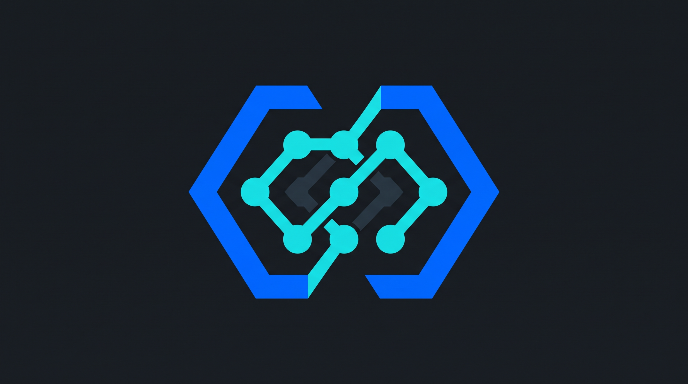

# Brand Guidelines — TokenGateway

## Status dan sumber identitas

Pemilik memberikan logo melalui percakapan dan mengidentifikasikannya sebagai logo TokenGateway. Gunakan [referensi lokal](assets/tokengateway-logo-reference.jpeg) sebagai sumber bentuk dan karakter. File asli adalah JPEG RGB 2752 × 1536; latar gelap merupakan bagian gambar, bukan transparansi.

SHA-256 referensi: `87360b16fab6a535cf24830ebaa0ada6bd65ff290696099483bd0a9c570e4ed6`.

Logo ini menetapkan identitas; kebutuhan berikutnya adalah master vector dengan bentuk yang sama untuk ukuran fleksibel. Jangan meminta pemilik memilih logo lain hanya karena file saat ini raster. Konversi/penyiapan vector belum dilakukan dalam paket brief ini.

## Anatomi logo yang harus dipertahankan

- Dua bidang biru bersudut yang membentuk siluet heksagonal terbuka, bukan hexagon solid generik.
- Jalur cyan dengan simpul bulat dan hubungan diagonal yang membentuk rangkaian di pusat.
- Sambungan cyan di sisi atas/bawah yang menyatu dengan ritme rangka luar.
- Aksen bracket/kode abu gelap di tengah, termasuk ruang negatifnya.
- Ketebalan jalur, ukuran simpul, simetri visual, sudut, serta celah yang mengikuti referensi.

Vector master harus memakai path/shape asli. Menempel JPEG ke `<image>` di dalam SVG tidak memenuhi kebutuhan. Jangan mengganti mark dengan logo “AI circuit” dari stok atau menciptakan susunan node baru. Untuk third-party marks, gunakan master resmi, bukan bentuk yang ditebak dari nama provider.

## Palet awal

JPEG memiliki variasi warna akibat kompresi. Nilai berikut adalah **usulan normalisasi** untuk design system, dengan karakter diambil dari bidang dominan logo; bukan kode warna resmi yang diberikan sebagai master.

| Primitive | Nilai usulan | Peran |
|---|---|---|
| `brand.blue` | `#0066FF` | Identitas utama, mark, tombol/indikator terpilih |
| `brand.cyan` | `#16DDE2` | Highlight kata, jalur/node, nilai penting |
| `neutral.charcoal` | `#181D23` | Kanvas utama yang dekat dengan referensi |
| `neutral.surface` | `#202832` | Card dan IDE panel |
| `neutral.line` | `#344250` | Divider/border terukur |
| `neutral.text` | `#F4F7FA` | Teks utama |
| `neutral.muted` | `#AEBBC8` | Subline, label dan metadata |
| `neutral.codeAccent` | `#293744` | Aksen bracket gelap; jangan dijadikan teks kecil |

Hierarki aplikasi: latar charcoal dominan; teks terang; cyan hanya pada pesan penting; biru untuk identitas dan interaksi yang terpilih. Satu slide mengutamakan satu highlight. Provider marks mempertahankan warna resminya, termasuk blue DeepSeek dan warna Gemini; tidak diseragamkan menjadi cyan.

Uji contrast pada pasangan yang benar-benar digunakan. Cyan dengan teks charcoal cocok untuk CTA terang; tombol biru memerlukan verifikasi contrast terhadap ukuran/weight label, jangan menganggap putih otomatis cukup. Detail contrast dan role mapping di [design-system brief](04_DESIGN_SYSTEM_BRIEF.md).

## Typography

**Plus Jakarta Sans:** headline, subline, label, CTA, harga IDR. Utamakan 700/800 untuk headline dan 400/500/600 untuk informasi.

**JetBrains Mono:** kuota, model ID, base URL, code lines, dan metadata teknis pendek. Jangan menulis seluruh paragraf promosi dengan mono.

Font dimuat lokal dengan weight asli. Hindari font futuristik sempit yang menyulitkan membaca nominal dan endpoint. Ukuran canvas dan UI memiliki skala berbeda; jangan memakai ukuran font form studio untuk slide 1080px.

## Penggunaan mark dan wordmark

Wordmark teks: **TokenGateway**, kapital T dan G, tanpa underscore. Nama proyek teknis dapat memakai slug, tetapi copy pengguna tidak memakai `TOKEN_GATEWAY`.

Aturan proyek yang diusulkan:

- Pada slide 1080px, tinggi mark header 48–64px; footer 40–48px bila detail tetap terbaca.
- Untuk spotlight identitas, mark dapat 180–280px, selalu di dalam safe area.
- Clear space minimum 25% tinggi mark pada semua sisi, di luar batas artwork dan setelah intrinsic whitespace dinormalisasi.
- Lockup mark + teks memakai gap 16px untuk canvas; UI memakai token skalanya sendiri.
- Pertahankan aspect ratio. Rujukan JPEG landscape bukan bounding box final mark; whitespace latar boleh dikeluarkan saat menyiapkan master.
- Tidak ada stretch, rotasi, skew, glow, drop shadow, gradient baru, node tambahan, atau crop terhadap mark.
- Monochrome dan light-background variant belum ditetapkan. Jangan otomatis membuat recolor dan menamainya approved.

## Visual grammar

Gunakan grid, typography, rule tipis, card seperlunya, dan blok data yang punya tujuan. Garis rangkaian hanya hadir pada logo; jangan memperbanyak kabel dekoratif di seluruh slide. Satu fungsi informasi per card. Gunakan ruang kosong untuk memisahkan ide.

Do: headline besar dengan baseline rapi; angka harga yang tepat; kuota mono; model mark autentik; IDE card bersih; QRIS word badge pada plaque yang terbaca.

Avoid: robot/otak 3D, gambar neon acak, partikel bokeh, banyak floating chips, glass blur, texture/noise berat, ikon palsu provider, QR matrix dekoratif, dan technical labels yang tidak membantu calon pengguna.

## Voice dan tone

Suara brand: developer Indonesia yang paham produk dan menjelaskan dengan jelas. Gunakan **“kamu”** untuk konten, **“Anda”** boleh dipertahankan pada dokumentasi formal. Gaya “gw/lu” cocok untuk percakapan pemilik, tetapi tidak otomatis menjadi suara seluruh brand.

| Konteks | Nada | Contoh |
|---|---|---|
| Hook | Pendek dan konkret | “Mulai pakai API AI dari Rp10.000.” |
| Offer | Jelas, lengkap | “GLM 5.3 Flash · 50 juta token · 7 hari.” |
| Tutorial | Langkah nyata | “Isi base URL, lalu pilih model sesuai paket.” |
| Troubleshooting | Tenang, membantu | “Cek izin model pada paket dan API key kamu.” |
| CTA | Satu aksi | “Lihat paket GLM.” |

Hindari “revolusi produktivitas”, “solusi mutakhir”, “potensi tak terbatas”, “paling pintar”, “100× lebih cepat”, atau “pasti hemat” tanpa bukti. Tidak ada fake testimonial, dashboard metrik palsu, atau angka jumlah pengguna yang belum tersedia.

## Lexicon

“Paket” = harga, kuota token, akses model, dan masa berlaku. “Pass” = kategori sesuai katalog; kategori `single` tidak selalu berarti persis satu model ID. “Kuota token” tidak sama dengan context window, jumlah prompt, jumlah kata, atau durasi coding. “Harga paket” tidak sama dengan total checkout. “Akses model” mengikuti paket, akun, dan API key. “QRIS” memakai huruf kapital; harga Indonesia ditulis `Rp10.000`; `50M` di badge teknis ditulis bersama penjelasan `50 juta token` untuk pengguna baru.
